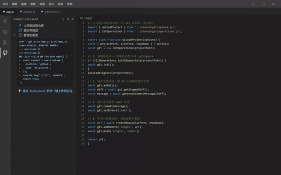
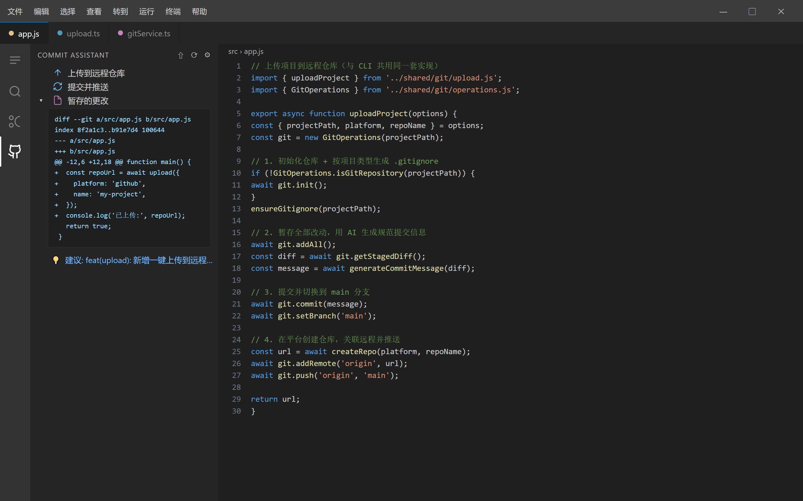
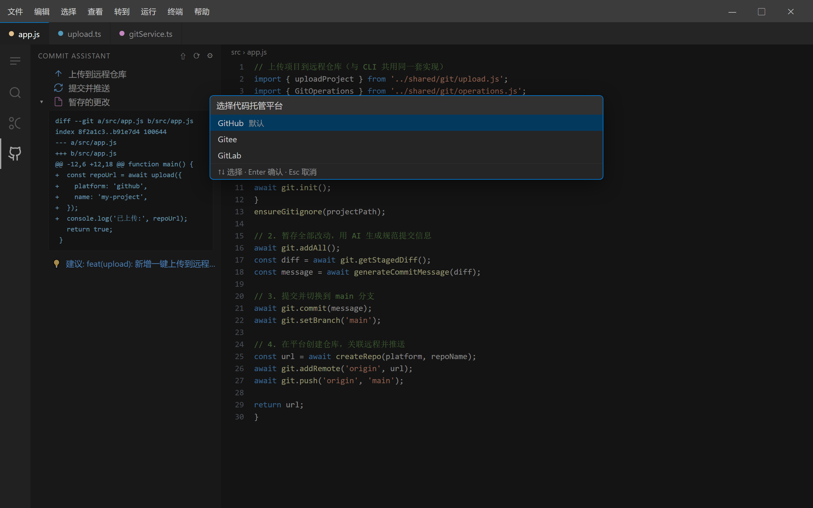
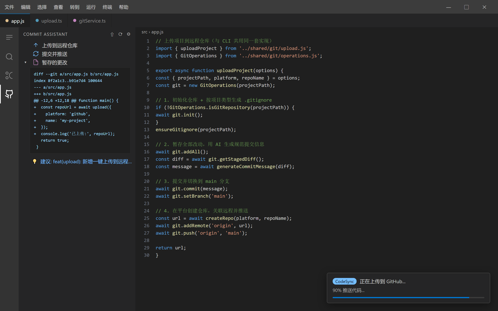

# 📦 CodeSync v2.0

**Simplified Git operations + AI code assistant**

> Say goodbye to tedious Git commands — anyone can manage their code, and AI boosts development efficiency.

[](https://www.npmjs.com/package/codesync)
[](./LICENSE)
[](FEATURES_COMPLETE.md)

**English** | [简体中文](README_ZH.md)

## 🎉 What's New in v2.0

- 🤖 **Smart code upload assistant** — a fully automated upload experience
- 🎣 **Pre-commit hook templates** — ESLint, Prettier, TypeScript and more
- 📝 **Commit template library** — 8 built-in templates + custom templates
- 📊 **Web dashboard** — project statistics and visualization
- 🔌 **Plugin system** — an extensible plugin architecture
- 🚀 **Automated deployment** — Vercel, Netlify, Docker, NPM
- 📦 **Release automation** — create a release with one command
- 🔍 **Code search** — text search and semantic search
- 🔒 **License compliance checks** — dependency license scanning

**[View the full feature documentation →](FEATURES_COMPLETE.md)**

**One core, three front-ends** — the CLI, desktop app and VS Code extension all share the `shared/` module and the `~/.git-commit-ai.json` config file, so behavior is identical everywhere.

**🎯 Want to push code straight from VS Code?** → Jump to [VS Code Extension Guide](#6-vs-code-extension-guide)



**📚 Documentation index**

| Document | Description |
| --- | --- |
| [CHANGELOG.md](./CHANGELOG.md) | Full changelog |
| [RELEASE_GUIDE.md](./RELEASE_GUIDE.md) | Release guide (GitHub Release / npm / Marketplace) |
| [vscode-extension/README.md](./vscode-extension/README.md) | VS Code extension usage |
| [vscode-extension/PUBLISHING.md](./vscode-extension/PUBLISHING.md) | Publishing the extension to the VS Code Marketplace |
| [FEATURES_COMPLETE.md](./FEATURES_COMPLETE.md) | Complete feature list |
| [AGENT_GUIDE.md](./AGENT_GUIDE.md) | Smart upload assistant (Agent) guide |

---

## 🎯 What Problem Does It Solve?

| Pain point                                                  | How CodeSync solves it                                             |
| --------------------------------------------------------- | ------------------------------------------------------------------- |
| Can't remember `git add . && git commit -m "..." && git push` | One `codesync upload` does it all                                  |
| Commit messages are sloppy, so code review is hard         | AI analyzes the diff and generates Angular/Gitmoji-style messages  |
| Even small changes take time to think of a message for      | Smart model selection — big diffs use a strong model, small diffs a fast one |
| Want comments on code, an explanation, or a review          | `codesync ai annotate/explain/review` in one command                |
| Team members use inconsistent commit formats                | Git hooks enforce the format + shared team configuration            |
| Dependencies must be installed manually after downloading    | `codesync download url --install` handles it automatically          |
| Switching between GitHub / Gitee / GitLab                    | A unified interface that creates repositories on all three         |

---

## ✨ Core Features

### 📤 Git operations, simplified

- **One-click upload** — auto-initialize the repository, generate an AI commit message, create the remote repository and push
- **One-click download** — auto-clone and auto-install dependencies (npm/pnpm/yarn)
- **Smart update** — detect changes, generate a commit message and push to the remote
- **Version rollback** — pick a commit interactively and roll back safely

### 🤖 AI code assistant

- **Smart commits** — analyze diff complexity, pick the right model, generate a well-formed commit message
- **Code annotation** — generate detailed comments for any code file
- **Code explanation** — explain functionality, key functions and execution flow
- **Code review** — a full review across quality, potential bugs, performance and security
- **Automatic changelog** — analyze all commits between two tags and generate a changelog

### 🤖 AI code review bot

- **Automated PR reviews** — an AI review comment for every pull request
- **Multi-dimensional analysis** — code quality, potential bugs, performance and security
- **Dual-platform support** — GitHub and GitLab webhook integration
- **Configurable rules** — custom review strictness, language and allow/deny lists
- **Smart filtering** — automatically skip large diffs and denied files

### 💻 VS Code extension

- **One-click upload** — upload the project to GitHub / Gitee / GitLab from the editor, creating the repository and pushing
- **Commit and push** — stage all changes → AI-generated commit message (editable) → commit → push the current branch
- **Commit panel** — watch staged changes live and generate a commit message in one click
- **AI in the context menu** — select text and run explain / annotate / review
- **Live diff preview** — inspect staged changes in the sidebar
- **Activity bar icon** — the CodeSync icon in the activity bar
- **Multi-language support** — English, Chinese and Japanese commit messages
- **Shared configuration** — shares `~/.git-commit-ai.json` with the CLI and desktop app; configure once, use everywhere
- **Shared core logic** — the extension reuses `shared/` directly, so it behaves exactly like the CLI

### 👥 Team collaboration

- **Shared team configuration** — one commit convention, API configuration and model selection for the whole team
- **Git hook enforcement** — commit messages are validated automatically on every commit
- **Multi-platform support** — GitHub / Gitee / GitLab with a single command set

### 🎨 Commit conventions

- **Angular** — `feat:`, `fix:`, `docs:`, `style:`, `refactor:`, `test:`, `chore:`
- **Gitmoji** — `✨`, `🐛`, `📝`, `🎨`, `♻️`, `✅`, `🔧`
- **Multi-language commits** — Chinese, English, Japanese and more

---

## 📦 Installation

### Requirements

- Node.js >= 16.0
- Git installed

### CLI installation

```bash
# Clone the project
git clone <repo-url>
cd git-commit-ai

# Install dependencies (installs all workspaces at once)
npm install

# Link the CLI globally
npm run link:cli

# Verify the installation
codesync --version
```

### Desktop app
 
```bash
# Ensure you are in the project root directory
cd git-commit-ai

# Install desktop dependencies
npm run install:desktop

# Start in development mode
npm run desktop:dev
# or: cd desktop && npm run dev
```

### VS Code extension

```bash
# Install extension dependencies
cd vscode-extension
npm install

# Build the extension
npm run compile

# Development mode: open the vscode-extension folder in VS Code and press F5
```

### Initial setup (first run)

```bash
# Interactive setup wizard for API keys and more
codesync init

# Or configure manually
codesync config set apiKey=sk-xxx
codesync config set githubToken=ghp_xxx
```

---

## 🚀 Quick Start

### 1. Configure the API

```bash
# Interactive setup (recommended for first run)
codesync init

# Manual setup
codesync config set apiKey=sk-xxx                    # OpenAI API key
codesync config set githubToken=ghp_xxx             # GitHub token (required for upload)
codesync config set gitlabToken=glpat-xxx           # GitLab token (optional)
codesync config set apiBase=https://api.openai.com/v1  # API base URL (proxy friendly)
```

#### 🔑 Where to get a token
 
| Platform | Token type | Where to create it | Required scope |
|----------|-----------|--------------------|----------------|
| **GitHub** | Personal Access Token (classic) | https://github.com/settings/tokens (or [direct link](https://github.com/settings/tokens/new?scopes=repo&description=codesync)) | Check the `repo` scope (classic token required) |
| **Gitee** | Private token | https://gitee.com/profile/personal_access_tokens | Check the `projects` scope |
| **GitLab** | Personal Access Token | https://gitlab.com/-/user_settings/personal_access_tokens | Scope `api` |
| **OpenAI** | API key | https://platform.openai.com/api-keys | - |

> Show the current configuration and token status: `codesync config --list`

### 2. Upload a project

```bash
# Upload the current project to GitHub
codesync upload --platform github --name my-project

# Upload to a private repository
codesync upload --platform github --name my-project --private

# Upload to Gitee
codesync upload --platform gitee --name my-project

# Upload to GitLab
codesync upload --platform gitlab --name my-project
```

### 3. Download a project

```bash
# Download and install dependencies automatically
codesync download https://github.com/user/repo.git --install

# Download to a specific directory
codesync download https://github.com/user/repo.git --dir ./my-folder
```

### 4. AI-generated commit messages

```bash
# Standard mode (interactive confirmation)
codesync ai commit

# Fast mode (commit immediately, no confirmation)
codesync ai commit --yes

# Choose a convention
codesync ai commit --convention gitmoji

# Choose a language
codesync ai commit --language en
```

### 5. AI code assistant

```bash
# Annotate code (generate comments)
codesync ai annotate -f src/app.js

# Explain code
codesync ai explain -f src/app.js

# Review code
codesync ai review -f src/app.js
```

### 6. VS Code Extension Guide

> See [`vscode-extension/README.md`](./vscode-extension/README.md) for the full details.



| Sidebar | Platform selection | Upload progress |
| --- | --- | --- |
|  |  |  |

#### 6.1 Install the extension

**Option A: development mode (run from source, recommended for contributors)**

```bash
cd vscode-extension
npm install
npm run compile
```

Then open the `vscode-extension` folder in VS Code and press `F5` to launch the Extension Development Host, which opens a new VS Code window with the extension loaded.

**Option B: install the .vsix package (regular users)**

```bash
cd vscode-extension
npm install
npm run compile
npx vsce package          # produces codesync-vscode-<version>.vsix
code --install-extension codesync-vscode-<version>.vsix
```

After installation you will see the **CodeSync** icon in the activity bar on the left.

#### 6.2 First-time configuration (required)

The extension **does not store its own configuration**. It shares a single config file, `~/.git-commit-ai.json`, with the CLI and the desktop app — configure it once in the CLI and the extension and desktop app pick it up immediately:

```bash
# Required for AI features (commit message / annotate / explain / review)
codesync config set apiKey=sk-xxx

# Required for uploading to GitHub (PAT with the repo scope)
codesync config set githubToken=ghp_xxx

# For Gitee / GitLab set the matching token
codesync config set giteeToken=xxx
codesync config set gitlabToken=xxx
```

You can also configure everything from the extension (`Ctrl+Shift+P`):

| Command | Purpose |
| --- | --- |
| `CodeSync: Configure Platform Token` | Pick a platform, paste the token, save it to `~/.git-commit-ai.json` |
| `CodeSync: Show Current Configuration` | Show the effective configuration (sensitive values are masked) |
| `CodeSync: Open Settings` | Open the VS Code settings panel |

> The `codesync.*` settings inside the extension are **empty by default**, meaning "use the value from `~/.git-commit-ai.json`". Only an explicit value overrides it. Precedence: **VS Code settings > environment variables > config file**.

#### 6.3 Command reference

All commands are available from `Ctrl+Shift+P` (the command palette) and from the icons at the top of the sidebar.

| Command | Where | Description |
| --- | --- | --- |
| `CodeSync: Upload Project to Remote Repository` | Sidebar ⬆️ / palette | **Upload the project** to GitHub / Gitee / GitLab |
| `CodeSync: Commit and Push` | Sidebar 🔄 / palette | Stage changes → AI commit message → commit → push |
| `CodeSync: Generate Commit Message` | Sidebar item | Generate a commit message from the staged diff and commit |
| `CodeSync: Explain Selected Code` | Context menu | Explain the selected code |
| `CodeSync: Annotate Selected Code` | Context menu | Generate detailed comments for the selected code |
| `CodeSync: Review Selected Code` | Context menu | Review the selected code (quality / bugs / performance / security) |
| `CodeSync: Configure Platform Token` | Sidebar ⚙️ menu | Configure a platform token |
| `CodeSync: Show Current Configuration` | Sidebar ⚙️ menu | Show the current configuration |
| `CodeSync: Refresh Diff` | Sidebar 🔄 | Refresh the staged diff |
| `CodeSync: Open Settings` | Sidebar ⚙️ menu | Open the settings |

#### 6.4 Upload a project to a remote repository (key feature)

`Ctrl+Shift+P` → `CodeSync: Upload Project to Remote Repository`, then follow the prompts:

1. **Choose a platform** — GitHub / Gitee / GitLab
2. **Enter the repository name** — defaults to the current folder name
3. **Enter the repository description** — optional
4. **Choose visibility** — public / private
5. **Confirm the details** — confirm to start the upload
6. **Token check** — if the platform has no token yet, you are prompted and it is saved automatically
7. **Upload** — a progress bar in the bottom right shows every step in real time:

```
[10%] Checking the Git repository...
[20%] Generated .gitignore (node template)...
[30%] Adding files...
[40%] Generating the commit message...
[50%] Committing changes...
[60%] Setting the branch...
[70%] Creating the repository on github...
[80%] Linking the remote...
[90%] Pushing the code...
[100%] Done!
```

When the upload finishes, a dialog shows the repository URL that you can **copy in one click** or **open in the browser**.

> If the current directory already has a remote repository, the extension suggests using "Commit and Push" instead, to avoid creating a duplicate repository.

#### 6.5 Commit and push

`Ctrl+Shift+P` → `CodeSync: Commit and Push`:

1. The extension runs `git add .` to stage all changes
2. It calls the AI to generate a commit message from the diff (picking a fast/slow model automatically, with caching)
3. An input box appears so you can **edit** the generated message
4. On confirmation it runs `git commit` + `git push`, with a live progress bar
5. If there is nothing to commit, it reports "no changes to commit" instead of creating an empty commit

#### 6.6 The sidebar panel

Click the **CodeSync** icon in the activity bar to expand "Commit Assistant":

```
☁️  Upload to Remote Repository   ← click to run the upload flow
🔄  Commit and Push               ← click to run the sync flow
📂  Staged Changes                ← expand to preview the first 500 chars of the diff
💡  Suggestion: feat(api): add upload endpoint   ← AI-suggested commit message
```

#### 6.7 AI code assistant

Select a block of code in the editor and use the context menu:

| Context menu item | Result |
| --- | --- |
| `CodeSync: Explain Selected Code` | Opens a Markdown document explaining the functionality, key functions, execution flow and optimization ideas |
| `CodeSync: Annotate Selected Code` | Opens a document with detailed comments added to the code (logic unchanged) |
| `CodeSync: Review Selected Code` | Opens a Markdown document reviewing quality, bugs, performance and security |

#### 6.8 Extension settings

Search for `CodeSync` in the VS Code settings:

| Setting | Default | Description |
| --- | --- | --- |
| `codesync.apiKey` | empty | Overrides the API key in `~/.git-commit-ai.json` |
| `codesync.apiBase` | empty | Overrides the API base URL (useful with a proxy) |
| `codesync.model` | empty | Overrides the default model |
| `codesync.convention` | empty | Overrides the commit convention (`angular` / `gitmoji`) |
| `codesync.language` | empty | Overrides the commit language (`en` / `zh` / `ja`) |
| `codesync.smartModel` | empty | Overrides smart model selection |
| `codesync.fastModel` / `codesync.powerfulModel` | empty | Overrides the fast / powerful model |
| `codesync.githubToken` / `giteeToken` / `gitlabToken` | empty | Overrides the platform tokens |
| `codesync.gitlabBase` | empty | Overrides the GitLab API base URL (for self-hosted GitLab) |
| `codesync.platform` | `github` | The platform selected by default when uploading |
| `codesync.bypassHooks` | `false` | Skip Git hook validation (keep it off when team rules are enforced) |

#### 6.9 FAQ

**Q: The upload says "GitHub token is not configured"**
A: `Ctrl+Shift+P` → `CodeSync: Configure Platform Token` and paste the token, or run `codesync config set githubToken=xxx`.

**Q: It says "API key is not configured" and the AI features do not work**
A: Run `codesync config set apiKey=sk-xxx`, or use `Open Settings` next to `CodeSync: Configure Platform Token` and fill in `codesync.apiKey`.

**Q: The commit fails hook validation**
A: This is expected when the team has installed an enforcing commit-message hook. Fix the message, or temporarily set `codesync.bypassHooks` to `true`.

**Q: The upload went to the wrong directory in a multi-root workspace**
A: The extension prefers the **directory of the currently open file**, then the first workspace folder. Switch to the target file and run the command again.

**Q: Do the extension and the CLI behave differently?**
A: No. The extension reuses `upload.js` / `operations.js` / `commit.js` / `annotate.js` from `shared/`, so it is literally the same code and the same configuration.

### 6.10 Commit and push (CLI)

```bash
# Stage changes → AI commit message → commit → push to the current branch
codesync push

# Provide the commit message and skip the AI
codesync push -m "feat: add upload button"

# Skip Git hook validation
codesync push --bypass-hooks
```

### 7. Advanced Git commands

```bash
# Show pending changes
codesync git diff

# Show the commit history
codesync git log

# Generate a changelog
codesync git changelog --from=v1.0.0 --to=v1.1.0

# Analyze the project
codesync git analyze

# Batch operations
codesync git batch

# Safe rollback
codesync git revert
```

### 8. Team collaboration

```bash
# Initialize the team configuration
codesync team init

# Enforce the team conventions (installs Git hooks)
codesync team enforce

# Read the team configuration
codesync team config
```

### 9. Cache management

```bash
# Show cache status
codesync cache --stats

# Clear the cache
codesync cache --clear
```

### 10. CI/CD integration

```bash
# Install the GitHub Actions workflow
codesync ci install --platform github

# Install the GitLab CI configuration
codesync ci install --platform gitlab

# Remove the CI/CD configuration
codesync ci uninstall --platform github
```

### 11. Security checks

```bash
# Scan the staged changes for secrets
codesync security scan

# Scan a single file
codesync security scan --file src/config.js

# Pre-commit hook detection
codesync security pre-commit

# License compliance check
codesync security license
```

### 12. AI code review bot

```bash
# Install the bot into the current project
codesync review-bot install

# Start the bot
codesync review-bot start

# Show the configuration
codesync review-bot config

# Uninstall the bot
codesync review-bot uninstall
```

### 13. Pre-commit hook management

```bash
# List the available hook templates
codesync hook list

# Install the ESLint hook
codesync hook install --template eslint

# Install the combined check hook
codesync hook install --template all --force

# Remove the hook
codesync hook uninstall
```

### 14. Commit template management

```bash
# List all templates
codesync template list

# Generate a commit message from a template
codesync template use --name feature

# Show template details
codesync template show --name bug-fix

# Add a custom template
codesync template add --name my-template --template "..." --description "..."

# Remove a custom template
codesync template remove --name my-template
```

### 15. Web dashboard

```bash
# Start the web dashboard
codesync dashboard

# Specify the port
codesync dashboard --port 3001
```

### 16. Plugin management

```bash
# List installed plugins
codesync plugin list

# Install a plugin
codesync plugin install --name my-plugin --type ai-provider --path ./plugins/my-plugin.js

# Uninstall a plugin
codesync plugin uninstall --name my-plugin

# Load a plugin
codesync plugin load --path ./plugins/custom-plugin.js
```

### 17. Automated deployment

```bash
# List the supported deployment platforms
codesync deploy list

# Configure the Docker deployment hook
codesync deploy hook --platform docker

# Configure the Vercel deployment hook
codesync deploy hook --platform vercel
```

### 18. Release automation

```bash
# Create a release
codesync release 1.0.0

# Create a prerelease
codesync release 1.0.0-beta.1 --prerelease

# Create a draft release
codesync release 1.0.0 --draft
```

### 19. Code search

```bash
# Search the code
codesync search "function login"

# Semantic search
codesync search "api authentication" --type semantic

# Search in a specific file
codesync search "TODO" --file src/index.js
```

### 20. Smart code upload assistant

```bash
# Setup wizard (recommended for the first run)
codesync agent-init

# Start the agent
codesync agent start

# Show the status
codesync agent status

# Stop the agent
codesync agent stop

# Show the configuration reference
codesync agent config

# Advanced startup options
codesync agent start --strategy smart
codesync agent start --strategy batch --batch-size 10
codesync agent start --strategy scheduled --interval 120
codesync agent start --no-ai --yes
codesync agent start --no-push
```

**How the agent works:**
- Watches for file changes automatically
- Generates commit messages with AI
- Commits and pushes to the remote repository automatically
- Supports 4 upload strategies: immediate, batch, smart and scheduled
- Behavior can be customized through the `.codesync-agent.json` config file

---

## 📋 Complete Command List

### Project management

| Command | Description |
| ------------------------- | ----------------------------------- |
| `codesync upload`         | Upload the current project to a remote repository              |
| `codesync download <url>` | Clone a remote project locally                  |
| `codesync update`         | Update the current project (add → commit → push) |
| `codesync push`           | Commit and push to the current branch             |

### AI features

| Command | Description |
| -------------------------------- | -------------------------- |
| `codesync ai commit`             | Analyze the diff, AI generates the commit message |
| `codesync ai annotate -f <file>` | Generate comments for a code file         |
| `codesync ai explain -f <file>`  | Explain what the code does               |
| `codesync ai review -f <file>`   | Review code quality               |

### Git tools

| Command | Description |
| ------------------------ | -------------- |
| `codesync git diff`      | Show pending changes |
| `codesync git log`       | Show the commit history   |
| `codesync git changelog` | Generate a CHANGELOG |
| `codesync git analyze`   | Analyze the project structure   |
| `codesync git batch`     | Batch Git operations  |
| `codesync git revert`    | Safely roll back a version   |

### Configuration

| Command | Description |
| ----------------------------------- | -------------- |
| `codesync init`                     | Interactive setup wizard |
| `codesync config`                   | Show the current configuration   |
| `codesync config set <key>=<value>` | Set a configuration item     |

### Team collaboration

| Command | Description |
| ----------------------- | ---------------- |
| `codesync team init`    | Initialize the team configuration   |
| `codesync team enforce` | Install the team convention hooks |
| `codesync team config`  | Show the team configuration     |

### AI review bot

| Command | Description |
| ------------------------------- | ------------------ |
| `codesync review-bot install`    | Install the review bot      |
| `codesync review-bot start`     | Start the review bot      |
| `codesync review-bot config`    | Show the configuration          |
| `codesync review-bot uninstall`  | Uninstall the review bot      |

### Utilities

| Command | Description |
| ------------------------ | ------------ |
| `codesync cache --stats` | Show cache statistics |
| `codesync cache --clear` | Clear all cached data |

### Security

| Command | Description |
| --------------------------------------- | ------------------ |
| `codesync security scan`                | Scan for sensitive information      |
| `codesync security scan --file <file>` | Scan a specific file      |
| `codesync security pre-commit`          | Pre-commit hook detection |
| `codesync security license`             | License compliance check    |

### CI/CD

| Command | Description |
| ----------------------------------------- | ------------------------ |
| `codesync ci install --platform github`   | Install GitHub Actions      |
| `codesync ci install --platform gitlab`   | Install GitLab CI           |
| `codesync ci uninstall --platform github`  | Remove the CI/CD configuration          |

### Pre-commit hooks

| Command | Description |
| ------------------------------------------------ | ------------------ |
| `codesync hook list`                              | List the available templates       |
| `codesync hook install --template <template>`     | Install a hook template    |
| `codesync hook install --template all --force`    | Force-install the combined template  |
| `codesync hook uninstall`                         | Remove the hook         |

### Commit templates

| Command | Description |
| ------------------------------------------------- | ------------------ |
| `codesync template list`                           | List all templates       |
| `codesync template use --name <name>`              | Use a template           |
| `codesync template show --name <name>`            | Show template details       |
| `codesync template add --name <name> --template ...` | Add a custom template    |
| `codesync template remove --name <name>`           | Remove a custom template     |

### Web dashboard

| Command | Description |
| --------------------------------- | ------------------ |
| `codesync dashboard`              | Start the dashboard     |
| `codesync dashboard --port <port>` | Start on a specific port       |

### Plugin management

| Command | Description |
| --------------------------------------------------------------- | ------------------ |
| `codesync plugin list`                                          | List installed plugins     |
| `codesync plugin install --name <name> --type <type> --path ...` | Install a plugin           |
| `codesync plugin uninstall --name <name>`                       | Uninstall a plugin           |
| `codesync plugin load --path <path>`                            | Load a plugin           |

### Automated deployment

| Command | Description |
| --------------------------------------------- | ------------------ |
| `codesync deploy list`                         | List the deployment platforms       |
| `codesync deploy hook --platform <platform>`  | Configure the deployment hook       |

### Release management

| Command | Description |
| --------------------------------- | ------------------ |
| `codesync release <version>`       | Create a release       |
| `codesync release <version> --prerelease` | Create a prerelease    |
| `codesync release <version> --draft`       | Create a draft release  |

### Code search

| Command | Description |
| ------------------------------------------------ | ------------------ |
| `codesync search "<query>"`                       | Search the code           |
| `codesync search "<query>" --type semantic`       | Semantic search           |
| `codesync search "<query>" --file <file>`         | Search in a specific file       |

### Smart code upload assistant

| Command | Description |
| ------------------------------------------------- | ------------------ |
| `codesync agent-init`                              | Setup wizard           |
| `codesync agent start`                             | Start the agent         |
| `codesync agent stop`                              | Stop the agent         |
| `codesync agent status`                            | Show the status           |
| `codesync agent config`                            | Configuration reference           |
| `codesync agent start --strategy <type>`           | Choose the upload strategy       |
| `codesync agent start --batch-size <number>`       | Batch upload threshold       |
| `codesync agent start --interval <seconds>`        | Scheduled upload interval       |

---

## ⚙️ Configuration

| Option | Description | Default |
| --------------- | ------------------- | --------------------------- |
| `apiKey`        | AI API key (required) | -                           |
| `apiBase`       | API base URL        | `https://api.openai.com/v1` |
| `model`         | Default model            | `gpt-4o-mini`               |
| `smartModel`    | Model for complex tasks      | `gpt-4o`                    |
| `fastModel`     | Model for simple tasks      | `gpt-4o-mini`               |
| `powerfulModel` | Model for heavy tasks      | `gpt-4o`                    |
| `githubToken`   | GitHub personal access token | -                           |
| `giteeToken`    | Gitee private token      | -                           |
| `gitlabToken`   | GitLab private token     | -                           |
| `gitlabBase`    | GitLab instance URL     | `https://gitlab.com`        |
| `convention`    | Commit convention            | `angular`                   |
| `language`      | Commit message language        | `zh`                        |
| `cacheTTL`      | Cache TTL (milliseconds)    | `3600000`                   |
| `platform`      | Default platform            | `github`                    |

---

## 🌟 Use Cases

### Scenario 1: A Git beginner uploads their first project

```bash
# You just finished a project and want to push it to GitHub
# No need to know git init / add / commit / push

codesync init                                    # configure the API key first
codesync upload --platform github --name my-first-project
# Done! The repository is created, committed and pushed automatically
```

### Scenario 2: Quickly download and run an open-source project

```bash
# You want to learn from a GitHub project
codesync download https://github.com/vercel/next.js --install
# Auto-clone + auto-detect and install dependencies (npm/pnpm/yarn)
# Start learning right away
```

### Scenario 3: Generate a well-formed commit message before committing

```bash
git add .
codesync ai commit
# Output:
#   🤔 Analyzing changes...
#   ✨ Suggested commit message:
#   feat(auth): add user login validation
#
#   Confirm commit? [Y/n]
```

### Scenario 4: Add comments to code you don't understand

```bash
codesync ai explain -f src/utils/calc.js
# Detailed explanation: function purpose, parameters, return value, execution flow
```

### Scenario 5: Enforce commit conventions for a team

```bash
# The team lead initializes the team configuration
codesync team init
# Pick the Angular convention + enforcement

# Teammates install the hooks after cloning
codesync team enforce
# Every commit is validated from now on, and invalid ones are rejected
```

### Scenario 6: Push code to GitHub straight from VS Code

```bash
# 1. Open the project folder and activate the CodeSync icon in the activity bar
# 2. Click "Upload to Remote Repository" in the sidebar
#    or Ctrl+Shift+P -> CodeSync: Upload Project to Remote Repository
# 3. Follow the prompts: pick a platform (GitHub/Gitee/GitLab), enter the repository
#    name and description, choose public/private
# 4. After confirmation everything runs automatically: create .gitignore -> stage ->
#    AI commit message -> commit -> create the repository on the platform ->
#    link the remote -> push
# 5. When it finishes, a dialog shows the repository URL; copy it in one click
#    or open it directly in the browser
```

**No more typing Git commands, and you never leave the editor.**

```bash
# For later changes: click "Commit and Push" in the sidebar
# Stage all changes -> AI commit message (editable) -> commit -> push to the current branch
```

### Scenario 7: Use the AI features in VS Code

```bash
# Select some text in VS Code
# Right-click -> "Explain Code" -> AI explains the code
# Right-click -> "Annotate Code" -> AI adds comments
# Right-click -> "Review Code" -> AI reviews the code

# Open the CodeSync sidebar
# Inspect the staged changes
# Click "Generate Commit Message" to generate a commit message
```

---

## 🆚 Compared With Similar Tools

| Feature | CodeSync | commitizen | aicommits |
| --------------------------------- | -------- | ---------- | --------- |
| One-click upload to a remote repository | ✅       | ❌         | ❌        |
| Three platforms (GitHub/Gitee/GitLab) | ✅       | ❌         | ❌        |
| Automatic well-formed commit messages | ✅       | Manual selection | ✅        |
| Smart model selection (by diff complexity) | ✅       | ❌         | ❌        |
| Code annotation / explanation / review | ✅       | ❌         | ❌        |
| Automatic changelog | ✅       | ❌         | ❌        |
| Shared team configuration + hook enforcement | ✅       | Partial       | ❌        |
| Interactive setup wizard | ✅       | ❌         | ❌        |
| Desktop app | ✅       | ❌         | ❌        |
| VS Code extension | ✅       | ❌         | ❌        |

---

## 📁 Project Structure

```
git-commit-ai/
├── shared/                    # Shared core modules (npm workspace)
│   ├── git/
│   │   ├── operations.js     # Git operation wrappers
│   │   ├── upload.js         # Upload / sync flow
│   │   └── download.js       # Download flow
│   ├── ai/
│   │   ├── commit.js         # AI commit message generation
│   │   ├── prompts.js        # Prompt management
│   │   └── annotate.js       # Code annotation / explanation / review
│   ├── platform/
│   │   ├── github.js         # GitHub platform adapter
│   │   ├── gitee.js          # Gitee platform adapter
│   │   └── gitlab.js         # GitLab platform adapter
│   └── config.js             # Config management (reads/writes ~/.git-commit-ai.json)
├── cli/                      # CLI tool (npm workspace)
│   ├── bin/
│   │   └── codesync.js       # CLI entry point
│   └── src/
│       └── commands/         # Command implementations
│           ├── upload.js
│           ├── download.js
│           ├── update.js
│           ├── push.js       # Commit and push (reuses shared syncProject)
│           ├── ai.js
│           ├── config.js
│           ├── team.js
│           ├── cache.js
│           └── git.js
├── desktop/                  # Desktop app (npm workspace)
│   ├── src/
│   │   ├── main.js          # Electron main process
│   │   └── preload.js       # Preload script (IPC bridge)
│   └── components/
│       └── app.js           # Front-end UI (7 pages)
├── vscode-extension/        # VS Code extension
│   ├── src/
│   │   ├── extension.ts     # Extension entry point
│   │   ├── commitPanelProvider.ts  # Sidebar commit panel
│   │   ├── codeAssistant.ts # AI code assistant
│   │   ├── configManager.ts # Config management (reads ~/.git-commit-ai.json)
│   │   ├── gitService.ts    # Git service wrapper (reuses shared/git/*)
│   │   ├── commitTreeItem.ts # Tree view item
│   │   └── commands/        # Command implementations
│   │       ├── upload.ts    # Upload to a remote repository
│   │       ├── sync.ts      # Commit and push
│   │       └── config.ts    # Token / configuration viewer
│   ├── icons/               # Activity bar icon + Marketplace icon
│   ├── PUBLISHING.md        # Marketplace publishing guide
│   ├── CHANGELOG.md         # Extension changelog
│   └── package.json
├── .github/workflows/       # CI workflows
│   └── publish-vscode.yml   # Automatically publish the extension to the Marketplace
├── tests/                    # Test files
├── CHANGELOG.md             # Project changelog
└── package.json             # Root config (workspaces)
```

---

## 🔧 Development

```bash
# Install all dependencies (once, at the root)
npm install

# Run the tests
npm test

# Link the CLI globally (for development)
npm run link:cli

# Start the desktop app (development mode)
npm run install:desktop
cd desktop && npm run dev
```

### VS Code extension development

```bash
cd vscode-extension
npm install
npm run compile        # esbuild bundle (bundles shared/ into dist/extension.js)
npm run watch          # Watch mode
npx tsc --noEmit       # Type check
npx vsce package       # Package as .vsix
```

> The extension imports the `shared/` modules from the repository root directly, so changes in `shared/` affect the CLI, the desktop app and the extension at the same time — this is intentional, so that all three behave identically.

---

## 🤝 Contributing

Issues and pull requests are welcome!

---

## 📄 License

MIT License
