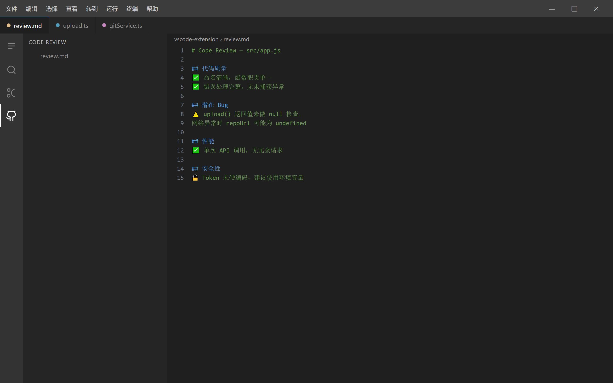

# CodeSync VS Code Extension

AI-powered Git assistant for Visual Studio Code — upload code, commit and push, and generate commit messages, annotations and reviews without leaving the editor.


## Features

### 🚀 Upload code to a remote repository


- **One-click upload**: `CodeSync: Upload Project to Remote Repository`
  Runs the whole flow: initialize the repository → generate `.gitignore` → stage → AI-generated commit message → commit
  → create the repository on the platform (GitHub / Gitee / GitLab) → link the remote → push
- **Commit and push**: `CodeSync: Commit and Push`
  Stage all changes → AI-generated commit message (editable) → commit → push to the current branch
- "Upload to Remote Repository" and "Commit and Push" buttons at the top of the sidebar


### 🤖 AI code assistant

- **Generate commit messages**: conventional commit messages (Angular / Gitmoji) from the staged diff
- **Explain code**: select text, then right-click `CodeSync: Explain Selected Code`
- **Annotate code**: select text, then right-click `CodeSync: Annotate Selected Code`
- **Review code**: select text, then right-click `CodeSync: Review Selected Code`
- **Live diff preview**: inspect staged changes in the sidebar



### ⚙️ Configuration and tokens

- **Show configuration**: `CodeSync: Show Current Configuration`
- **Configure platform token**: `CodeSync: Configure Platform Token`
- **Open settings**: `CodeSync: Open Settings`

## One core shared with the CLI and the desktop app

The extension no longer reimplements uploads and AI calls; it reuses the modules in `shared/` at the repository root:

| Capability | Reused module |
| --- | --- |
| Upload / sync flow | `shared/git/upload.js` |
| Git command wrappers | `shared/git/operations.js` |
| Repository creation on three platforms | `shared/platform/{github,gitee,gitlab}.js` |
| AI commit messages (with caching and smart model selection) | `shared/ai/commit.js` |
| AI annotate / explain / review | `shared/ai/annotate.js` |
| Config read / write | `shared/config.js` |

### Unified configuration

The **single source of truth** is `~/.git-commit-ai.json`, shared by the CLI, the desktop app and the VS Code extension:

```bash
codesync config set apiKey=sk-xxx
codesync config set githubToken=ghp_xxx
```

Every setting in the extension (`codesync.apiKey` and friends) is an **optional override**: leave it empty to use the value from the shared config;
once it is set explicitly, it is injected through an environment variable and takes precedence over the config file.

## Installation

> Want to publish to the VS Code Marketplace? See [PUBLISHING.md](./PUBLISHING.md).

### Development Mode

```bash
cd vscode-extension
npm install
npm run compile
code .
```

Press `F5` to launch a new VS Code window with the extension loaded.

### Production Mode

```bash
npm install -g vsce
vsce package
```

Install the generated `.vsix` file in VS Code.

## Configuration

All settings are empty by default, meaning "use the configuration from `~/.git-commit-ai.json`".

| Setting | Description |
| --- | --- |
| `codesync.apiKey` | OpenAI API key |
| `codesync.apiBase` | API base URL |
| `codesync.model` | Default model |
| `codesync.convention` | Commit convention (angular / gitmoji) |
| `codesync.language` | Commit language (en / zh / ja) |
| `codesync.smartModel` | Smart model selection |
| `codesync.fastModel` / `codesync.powerfulModel` | Fast / powerful model |
| `codesync.githubToken` / `giteeToken` / `gitlabToken` | Platform tokens |
| `codesync.gitlabBase` | GitLab API base URL |
| `codesync.platform` | Platform selected by default when uploading (github / gitee / gitlab) |
| `codesync.bypassHooks` | Skip Git hook validation (keep it off when team conventions are enforced) |

## Usage

### Upload a project

1. Open the project folder
2. `Ctrl+Shift+P` → `CodeSync: Upload Project to Remote Repository`
3. Choose a platform (GitHub / Gitee / GitLab), enter the repository name and description, and pick public/private
4. If no token is configured, you are prompted and it is saved to `~/.git-commit-ai.json`
5. When the upload finishes, copy the repository URL in one click or open it in the browser

### Commit and push

1. `Ctrl+Shift+P` → `CodeSync: Commit and Push`
2. You can keep editing the AI-generated commit message
3. On confirmation the changes are committed and pushed to the current branch automatically

## Development

```bash
npm run compile     # Build (esbuild, bundles shared/ into dist/extension.js)
npm run watch       # Watch build
npm run typecheck   # Type check
npm test            # Build + type check
```

> The extension imports the `shared/` modules from the repository root directly, so changes in `shared/` affect the CLI, the desktop app and the extension at the same time — this is intentional, so that all three behave identically.

## License

MIT
